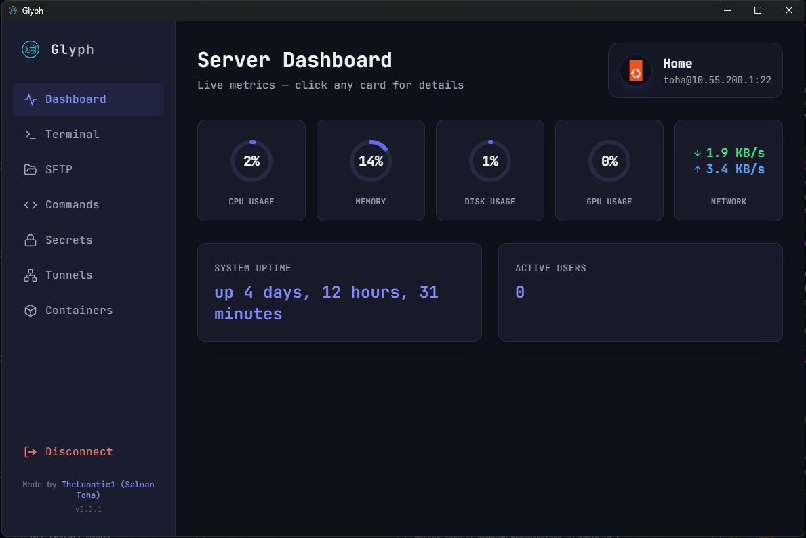

<div align="center">


# Glyph

**High-performance, 100% pure-Rust SSH client, server telemetry suite, dual-pane SFTP manager, Docker/Podman console, VNC-over-SSH viewer, and 36-tool MCP AI host.**

*Made by [TheLunatic1 (Salman Toha)](https://github.com/TheLunatic1)* · **v3.0.0** · Apache-2.0

<p>
  <a href="https://github.com/TheLunatic1/Glyph/releases"></a>
  <a href="https://github.com/TheLunatic1/Glyph/actions/workflows/ci.yml"></a>
  <a href="LICENSE"></a>
  <a href="https://github.com/TheLunatic1/glyph-app"></a>
</p>



</div>

---

> **Looking for the legacy Electron v2 codebase?** It is preserved untouched on the [`legacy-electron`](https://github.com/TheLunatic1/Glyph/tree/legacy-electron) branch (`v2.7.6`). Starting with **v3.0.0**, `main` is a complete **pure-Rust rewrite** with zero Node/Chromium overhead, zero CMake/NASM/OpenSSL build dependencies, and full visual & `.glyph` vault parity.

---

## Table of Contents

1. [Features](#features)
2. [Installation & Downloads](#installation--downloads)
3. [AI Agent Integration (MCP — 36 Tools)](#ai-agent-integration-mcp--36-tools)
4. [Security & Cryptography](#security--cryptography)
5. [Workspace Architecture](#workspace-architecture)
6. [Building from Source](#building-from-source)
7. [Automated CI/CD & Releases](#automated-cicd--releases)
8. [Contributing & License](#contributing--license)

---

## Features

### SSH, Host Management & Authentication
- **Host Groups, Tags & Reusable Identities:** Organize servers into collapsible nested host groups with cascading identity, jump-host, default port, and tag inheritance.
- **Full SSH Authentication Suite:** Connect via Vault-managed **Ed25519 / RSA-4096 / ECDSA-P256** keys, external private key files, passwords, system **SSH Agent** (`openssh-ssh-agent` / Pageant / `SSH_AUTH_SOCK`), **ProxyJump**, **SSH Agent Forwarding (`-A`)**, configurable keepalive, custom environment variables, startup commands, and **TCP/UDP Port Knocking**.
- **Trust-On-First-Use (TOFU) & Known Hosts:** Interactive fingerprint confirmation on first connect and strict mismatch warnings.
- **Importers & Cross-Ecosystem Vault:** Import from OpenSSH `~/.ssh/config`, PuTTY `.reg`, CSV, or DigitalOcean / Hetzner Cloud / Tailscale APIs, plus AES-256-GCM `.glyph` export/import interoperability with [Glyph Mobile (Android)](https://github.com/TheLunatic1/glyph-app).

### GPU-Accelerated Terminal & Quick Sessions
- **Multi-Tab & Split Panes (`alacritty_terminal` + `iced` canvas):** Smooth 24-bit truecolor terminal rendering, scrollback search, copy/paste, and theme presets.
- **Broadcast Input & Regex Highlights:** Mirror keystrokes across window tabs or all open server windows, and apply configurable regex color-highlighting rules to logs/prompts.
- **Session Recording:** Export sessions in **asciinema v2 (`.cast`)** format or plain `.log` transcripts, with optional per-host auto-logging.
- **Quick Launch Windows:** Native **Local Shell** (`pwsh` / `powershell` / `bash` / `zsh`), **Serial/UART** consoles (`COM` / `ttyUSB` / `ttyACM`), and **Telnet** clients.
- **Global Command Palette (`Ctrl+K` / `Cmd+K`):** Instant fuzzy launcher across servers, open windows, groups, Local/Serial/Telnet sessions, SSH keys, identities, importers, and vault lock.

### Live Telemetry, SFTP, Containers, Tunnels & VNC
- **Real-Time Server Dashboard:** Per-core CPU usage, memory & swap breakdown, disk partitions, network interface Rx/Tx rates, thermal sensors, and NVIDIA/AMD/Intel GPU metrics.
- **Dual-Pane SFTP & Remote-to-Remote Streaming:** Side-by-side **Remote ↔ Local** or **Remote ↔ Peer Server** browser, breadcrumbs, drag-and-drop uploads, cancellable transfer queue, inline `chmod`/rename/delete, and built-in remote file editor.
- **Docker / Podman & Compose:** Searchable container list, one-click `start` / `stop` / `restart`, resource limit updates, inspect & live stats, container logs viewer, and `docker compose up -d` / `down`.
- **Port Forwarding (`-L`, `-R`, `-D` SOCKS5):** Local forwarding, Remote forwarding, RFC 1928 Dynamic SOCKS5 proxies, and saved per-host auto-start tunnel profiles.
- **Pure-Rust VNC over SSH:** Embedded RFB 3.8 remote desktop client tunneled directly over SSH `direct-tcpip`.
- **Zero-Knowledge E2EE Sync & Master Lock:** Optional Argon2id master passcode + idle auto-lock, and zero-knowledge encrypted sync via local/cloud folders or WebDAV.

---

## Installation & Downloads

Prebuilt installers and binaries for **Windows**, **macOS (Apple Silicon + Intel Universal)**, and **Linux** are published automatically on [GitHub Releases](https://github.com/TheLunatic1/Glyph/releases):

| Platform | Artifacts |
|---|---|
| **Windows (x64)** | `Glyph-Setup-<version>.exe` *(installer with automatic in-app updates)*, `Glyph-v<version>-windows-x64.exe`, `Glyph-v<version>-windows-x64.zip` *(contains `Glyph.exe` + `glyph-mcp.exe`)* |
| **macOS (Universal)** | `Glyph-v<version>-macos-universal.dmg`, `Glyph-v<version>-macos-universal.zip` *(contains `Glyph.app` with bundled `glyph-mcp`)* |
| **Linux (x64)** | `Glyph-v<version>-linux-x64.AppImage`, `Glyph-v<version>-linux-x64.tar.gz` *(contains `glyph-desktop` + `glyph-mcp`)* |

> **Built-In In-App Auto-Updater:** Glyph checks GitHub Releases on startup and in **Settings → Updates**, displays release notes with streaming download progress, verifies binaries against `SHA256SUMS.txt`, and supports one-click **Restart & Install**. Existing **Glyph v2.7.6 (Electron)** users also receive an automatic upgrade prompt via `latest.yml` / `latest-mac.yml` / `latest-linux.yml`.

### macOS First Launch (Gatekeeper)
`Glyph.app` is ad-hoc signed without paid Apple notarization, so macOS shows *"Apple could not verify 'Glyph' is free of malware"* on first launch from GitHub Downloads:
1. Drag `Glyph.app` to **`/Applications`**.
2. Either go to **System Settings → Privacy & Security** and click **Open Anyway**, or run:
   ```bash
   xattr -cr /Applications/Glyph.app
   ```

---

## AI Agent Integration (MCP — 36 Tools)

Glyph ships with a native, standalone stdio MCP server (`glyph-mcp` / `glyph-mcp.exe`) backed by a Bearer-token authenticated loopback HTTP API (`127.0.0.1:15354`, token stored at `~/.glyph/mcp_token`).

When an AI assistant invokes MCP tools, **Glyph automatically launches visibly if closed**, focuses the target server window, streams commands/output into a dedicated **`AI Agent`** terminal tab, opens edited files live inside the **SFTP editor**, switches tabs cleanly across **Dashboard / Tunnels / Containers / Commands / Secrets / VNC**, and refreshes active state live.

### 1-Click In-App Setup
Open Glyph → **Settings → AI Agents (MCP)** and click **Auto-Install** next to:
- **Antigravity IDE** (`~/.gemini/config/mcp_config.json`)
- **Claude Desktop** (`claude_desktop_config.json`)
- **Claude Code CLI** (`~/.claude.json`)
- **Cursor** (`~/.cursor/mcp.json`)
- **VS Code** (`settings.json` under `mcp.servers`)

Or use the **Custom / Manual Setup** panel to target any custom MCP JSON file. Full schema & visualization details live in [`docs/MCP.md`](docs/MCP.md).

<details>
<summary><strong>All 36 Exposed MCP Tools & Live UI Behavior (Click to expand)</strong></summary>

| Category | Tools |
|---|---|
| **Servers & Terminal** | `glyph_list_servers`, `glyph_connect_server`, `glyph_disconnect_server`, `glyph_execute_command`, `glyph_get_server_stats` |
| **SFTP File Manager** | `glyph_read_file`, `glyph_write_file`, `glyph_sftp_list`, `glyph_sftp_mkdir`, `glyph_sftp_rename`, `glyph_sftp_chmod`, `glyph_sftp_delete`, `glyph_sftp_transfer` |
| **SSH Tunnels** | `glyph_list_tunnels`, `glyph_start_tunnel`, `glyph_start_remote_tunnel`, `glyph_start_socks_tunnel`, `glyph_stop_tunnel` |
| **Containers & Compose** | `glyph_list_containers`, `glyph_container_logs`, `glyph_container_inspect`, `glyph_container_action`, `glyph_compose_action` |
| **Commands & Packages** | `glyph_list_commands`, `glyph_add_command`, `glyph_remove_command`, `glyph_list_snippet_packages`, `glyph_add_snippet_package` |
| **Groups & Vault Metadata** | `glyph_list_groups`, `glyph_run_group_command`, `glyph_list_ssh_keys`, `glyph_list_identities`, `glyph_list_known_hosts` |
| **Secrets & VNC** | `glyph_list_secrets` *(names/IDs only)*, `glyph_add_secret`, `glyph_open_vnc` |

</details>

---

## Security & Cryptography

- **Local-First & Zero Telemetry:** No external analytics or cloud account required.
- **Pure-Rust Crypto:** `ring` (TLS/SSH), `aes-gcm` (AES-256-GCM vault & `.glyph` exports), `argon2` & `scrypt` (KDF), `zeroize` (memory scrubbing), OS `keyring` integration.
- **MCP Safety Boundaries:** By design, MCP **never** exposes decrypted secret values, SSH private key PEMs, key generation/deletion, host modification/deletion, local disk SFTP upload/download, VNC passwords, or destructive root deletions (`/` is rejected with HTTP `400`).

---

## Workspace Architecture

```
Glyph/
├── assets/                   # Fonts (IBM Plex Sans/Mono, Lucide icon font) & app icons
├── docs/MCP.md               # Complete 36-tool MCP & HTTP API reference
├── .github/workflows/        # Cross-OS CI, Release packaging, and Security Guard
└── crates/
    ├── glyph-core/           # Vault crypto, SSH/SFTP/Tunnels, PTY/Serial/Telnet, Telemetry, Containers, Importers, Sync, Updater
    ├── glyph-terminal/       # alacritty_terminal state, regex highlighter, asciinema recorder, Iced canvas widget
    ├── glyph-vnc/            # Pure-Rust RFB 3.8 client & Iced VNC viewport
    ├── glyph-api/            # Axum loopback REST API (127.0.0.1:15354) + UI event bus
    ├── glyph-mcp/            # Standalone stdio JSON-RPC 2.0 MCP server (auto-launches GUI)
    └── glyph-desktop/        # Cross-platform Iced multi-window app, tray, palette & modals
```

---

## Building from Source

Glyph uses **pure-Rust dependencies** (`ring`, `rustls-tls-webpki-roots-no-provider`) with **zero CMake, NASM, OpenSSL, or `aws-lc-sys` requirements**.

### Prerequisites
- Rust stable toolchain (`1.85+`, edition 2021)
- **Linux only (Debian/Ubuntu build deps):**
  ```bash
  sudo apt-get update && sudo apt-get install -y \
    libx11-dev libxkbcommon-dev libwayland-dev libgtk-3-dev libxdo-dev \
    libasound2-dev libdbus-1-dev libxcursor-dev libxi-dev libxinerama-dev \
    libxrandr-dev libvulkan-dev libfontconfig1-dev pkg-config
  ```

### Build & Test Commands

```bash
# Strict lint check across all crates & tests
cargo clippy --workspace --all-targets -- -D warnings

# Run all unit tests + loopback SSH/SFTP, VNC-over-SSH, REST API & MCP E2E suites
cargo test --workspace

# Build optimized release binaries (glyph-desktop + glyph-mcp)
cargo build --workspace --release
```

*(On Windows with constrained RAM during local debug builds, `set CARGO_PROFILE_DEV_DEBUG=0` and `-j 1` keeps `rustc` peak memory minimal.)*

---

## Automated CI/CD & Releases

- **[`ci.yml`](.github/workflows/ci.yml):** Runs on every push/PR across `ubuntu-latest`, `windows-latest`, and `macos-latest` — auditing `cargo tree` for zero `aws-lc`/`openssl-sys`, running `cargo clippy --workspace --all-targets -- -D warnings`, and executing the full `cargo test --workspace` suite.
- **[`release.yml`](.github/workflows/release.yml):** Triggers automatically whenever `Cargo.toml` changes on `main` (or manually via `workflow_dispatch`), creates tag `v<version>`, compiles release binaries across **Windows**, **macOS Universal (`aarch64` + `x86_64`)**, and **Linux (`x64`)**, and publishes packages + [`RELEASE_NOTES.md`](RELEASE_NOTES.md) directly to GitHub Releases.
- **[`security-guard.yml`](.github/workflows/security-guard.yml):** Scans every push/PR for malicious payloads and whitespace-obfuscated signatures.

---

## Contributing & License

Contributions, bug reports, and pull requests are welcome — see [`CONTRIBUTING.md`](CONTRIBUTING.md), [`CODE_OF_CONDUCT.md`](CODE_OF_CONDUCT.md), and [`AGENTS.md`](AGENTS.md).

Licensed under the [Apache License 2.0](LICENSE) · See [`NOTICE`](NOTICE).
